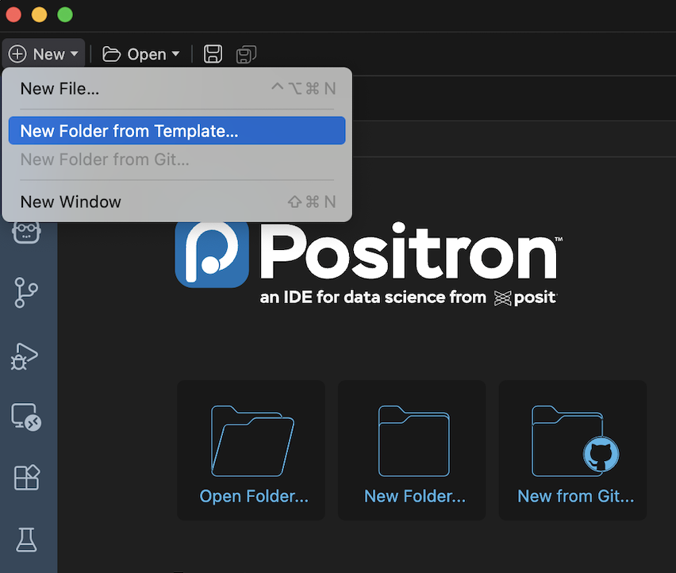
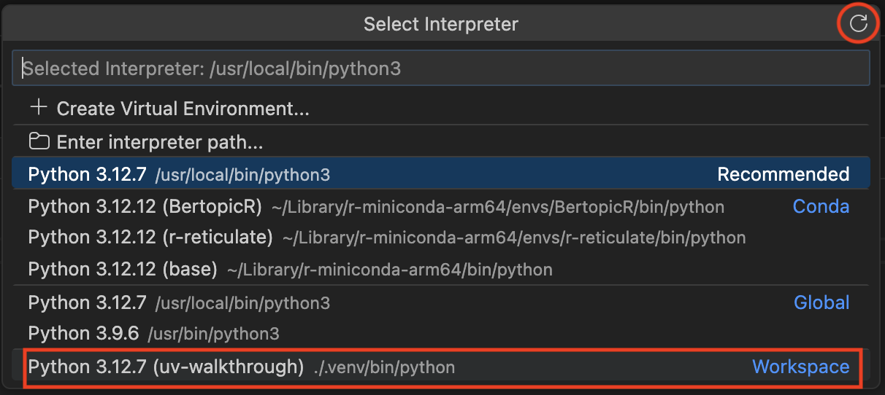
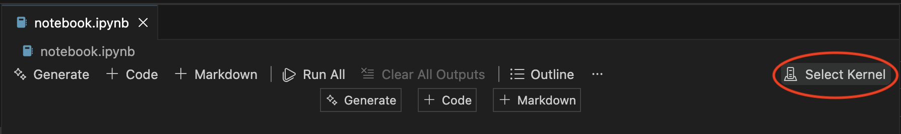

# Python Environments

A Python environment is a Python version along with installed packages.

-   Your global Python environment is the Python version installed on your computer, and any packages that you've installed.

-   A virtual Python environment is a folder that contains an interpreter (a version of Python, i.e `3.12`) and specific versions of packages that you've installed (i.e `numpy 2.4.1`).

## Why this matters

You can only have one version of an interpreter or a package installed in your global environment. What if you need a different version of Python for a particular project? What if packages conflict with each other? With a virtual environment you can set a specific version of Python, and you only need to include the packages you need for that project.

Best practice:

1\. Setup a project folder, like you would an Rproject, where all your code for that project will live.

2\. Create a virtual environment for that project, that includes the version of Python you need, and only the packages you require for that project.

## uv

uv is a package manager for Python. It's extremely fast, and really simple for quickly setting up a virtual environment.

### Installing uv

uv can be installed simply on MacOS using HomeBrew (recommended):

``` bash
brew install uv
```

uv can also be installed using pip (not recommended, can lead to circular dependency issues):

``` bash
pip install uv
```

### Installing Python

You can install Python with uv, really easily:

``` bash
uv python install 3.12
```

Including multiple versions if you need to (remember you can only use one at a time):

``` bash
uv python install 3.11 3.12
```

::: {.callout-tip collapse="true"}
#### Be cautious when installing the latest version of Python

The newest version of Python should be faster, and have more features. However, some packages may not have support for the newest version yet, and therefore won't be compatible. Make sure you are using a Python version that still has security support, you can see which do [here](https://www.python.org/downloads/).
:::

### Managing Python versions

You can view which versions of Python you've installed and which are available using:

``` bash
uv python list
```

If something has gone wrong with your Python, you can reinstall simply using:

``` bash
uv python install --reinstall
```

Note this reinstalls all versions of Python you have installed.

You can also manually upgrade a version of Python to the latest patch:

``` bash
uv python upgrade 3.12
```

## Setting up a project

### Navigating to a folder

You can open your project folder using the Positron interface (very similar to VsCode)



Select the folder where you want the project to live, and assign an appropriate name.

::: {.callout-tip collapse="true"}
#### You can also do this via the terminal

``` bash
# Create a folder
mkdir uv_walkthrough

# Navigate to it
cd uv_walkthrough
```
:::


::: {.callout-tip collapse="true"}
#### Don't store your environment on a Google Drive folder

Creating your environment on a Google Drive folder will create hundreds of tiny .py files that can cause Google Drive syncing to stall and crash.

To avoid this you can add the code below to your global `~/.zshrc` or `~/.bashrc` file:

#### zsh
``` zsh
autoload -Uz add-zsh-hook
_uv_env() {
  local root
  root=$(git rev-parse --show-toplevel 2>/dev/null) || { unset UV_PROJECT_ENVIRONMENT; return; }
  local hash=$(printf '%s' "$root" | shasum | cut -c1-8)
  export UV_PROJECT_ENVIRONMENT="$HOME/.local/share/uv/envs/$(basename "$root")_$hash"
}
add-zsh-hook chpwd _uv_env
_uv_env
```
#### bash
``` bash
_uv_env() {
  [[ "$PWD" == "$_UV_LAST_PWD" ]] && return
  _UV_LAST_PWD="$PWD"
  local root hash
  root=$(git rev-parse --show-toplevel 2>/dev/null) || { unset UV_PROJECT_ENVIRONMENT; return; }
  hash=$(printf '%s' "$root" | shasum | cut -c1-8)
  export UV_PROJECT_ENVIRONMENT="$HOME/.local/share/uv/envs/$(basename "$root")_$hash"
}
PROMPT_COMMAND="_uv_env${PROMPT_COMMAND:+;$PROMPT_COMMAND}"
```

You will also need to add this to your `~/.bash_profile` file:
``` bash
[ -f ~/.profile ] && . ~/.profile
[ -f ~/.bashrc ] && . ~/.bashrc
```

This will create the environment locally in your `.local/share/uv/envs/` folder rather than in the project folder.

:::

### uv init

Once you have navigated to your project folder, you can setup a new project really quickly by doing:

``` bash
uv init

# If you want to use a specific python version
uv init --python 3.12
```

This creates the following files:

\- `.python-version`

\- `README.md`

\- `main.py`

\- `pyproject.toml`

NOTE: `uv init` doesn't create the virtual environment, only initialises the project.

### Creating a virtual environment and Managing dependencies

There are two ways to create a virtual environment for your project:

1.  You can create an "empty" virtual environment, with no dependencies, using:

    ``` bash
    uv venv
    ```

2.  Or adding a dependency with uv automatically creates a virtual environment:

    ``` bash
    uv add numpy
    ```

Either way is fine and creates a `.venv` folder in your project directory. You can continue to add any packages you need using `uv add`, including specific versions:

``` bash
# Exact version
uv add pandas==2.0.3

# At least version 2.0, but less than 2.1
uv add "pandas>=2.0.0,<2.1.0"

# Greater or equal to 2.0.0
uv add "pandas>=2.0.0"

# Less than 2.2.0
uv add "pandas<2.2.0"
```

The reason you may want to install as specific version of a package, is due to conflicts between packages, this is when two or more packages in your environment require different (incompatible) versions of the same dependency.

::: {.callout-tip collapse="true"}
#### Only add dependencies you actually need

This is why it's important to only add packages that you actually need for your project, the more packages you have the more likely you will run into a package conflict.
:::

You can remove a package using:

``` bash
uv remove numpy
```

### Selecting your interpreter

Unless you select your interpreter in Positron you will end up using the default environment rather than the virtual environment you created. You can do this by pressing `CMD`+`SHIFT`+`P` in Positron and searching for "Python: Select Interpreter" and select your virtual environment.



::: {.callout-tip collapse="true"}
#### You can refresh the list of interpreters

If you've just created the virtual environment it may not show up in the list of interpreters until you press the refresh button in the top right of the Select Interpreter window.
:::

::: {.callout-note collapse="true"}
## You can also do this in terminal

``` bash
source .venv/bin/activate # Providing your .venv is in your current directory
```

This can be difficult to remember, to make this step easier you can add a "shell alias", which you can think of as a custom command, to activate your environment. Depending on which terminal you are using (`bash` or `zsh`) you need to add the following to your `~/.bashrc` or `~/.zshrc` files:

``` bash
alias activate="source .venv/bin/activate"
```

You can then type `activate` into your terminal to activate your environment.

Note: `~/bashrc` and `~/.zshrc` may not exist in your home directory, so you may need to create them first.

:::

#### Managing dependencies

**pyproject.toml:** This file is the readable (and editable) file containing project dependencies, including Python version and versions of packages in your environment. This file is automatically updated when you use "uv add".

**uv.lock:** This file records the precise version of every package you have installed on your virtual environment. This is automatically generated by uv when you create your virtual environment. Never edit this file manually.

You can edit `pyproject.toml` manually, however this would not update your uv.lock file. to ensure that `pyproject.toml` and uv.lock are consistent, use:

``` bash
# Update your lock file
uv lock

# OR: Update your lock file and install dependencies
uv sync
```

If you are using version control for your project, make sure to commit both of these files to git. This way other people (or yourself) can recreate your virtual environment.

### Pip commands

If you are familiar with using pip commands to install packages in python, uv has a built in replacement that works much faster. It has the same syntax as pip, for example:

``` bash
uv pip install pandas
```

This would install pandas straight into your active environment (Global or Virtual), however it would not update your `pyproject.toml` or `uv.lock` files. This means that if somebody tried to reproduce your environment using your project files (`pyproject.toml`, `uv.lock`, `.python-version`) they would get errors when they ran your code.

A guideline is to just use uv `pip` commands for quick tests, not for project work.

## Jupyter notebooks

When using R we write our project code in `.Rmd` files, the Python equivalent are Jupyter Notebooks (`.ipynb` files). First you need to add Jupyter to your project:

``` bash
uv add jupyter
```

You can create a new notebook by creating a file with the `ipynb` file extension. Then select your virtual environment in the kernel tab and you're good to go.



## Troubleshooting

If something goes catastrophically wrong with your virtual environment and you can't figure it out, you can delete your virtual environment and rebuild it using your `pyproject.toml` and `uv.lock` files:

``` bash
rm -rf .venv
uv sync
```

### Cleaning the cache

uv is so fast because it uses caching of packages, if rebuilding the virtual environment didn't work, and there are no package conflicts, cleaning the cache and then rebuilding the environment may solve your issue:

``` bash
# Clean the whole uv cache
uv cache clean

# Clean the cache for a specific package
uv cache clean pandas
```

## Further reading

1\. [uv documentation](https://docs.astral.sh/uv/) 

2\. [Python versions](https://www.python.org/downloads/)